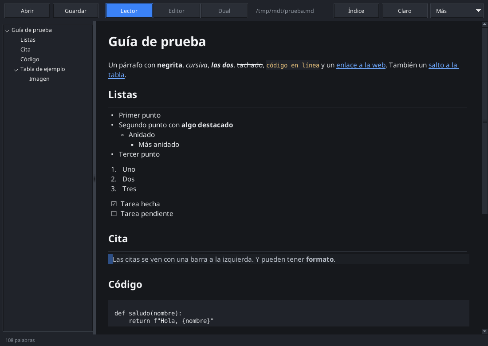
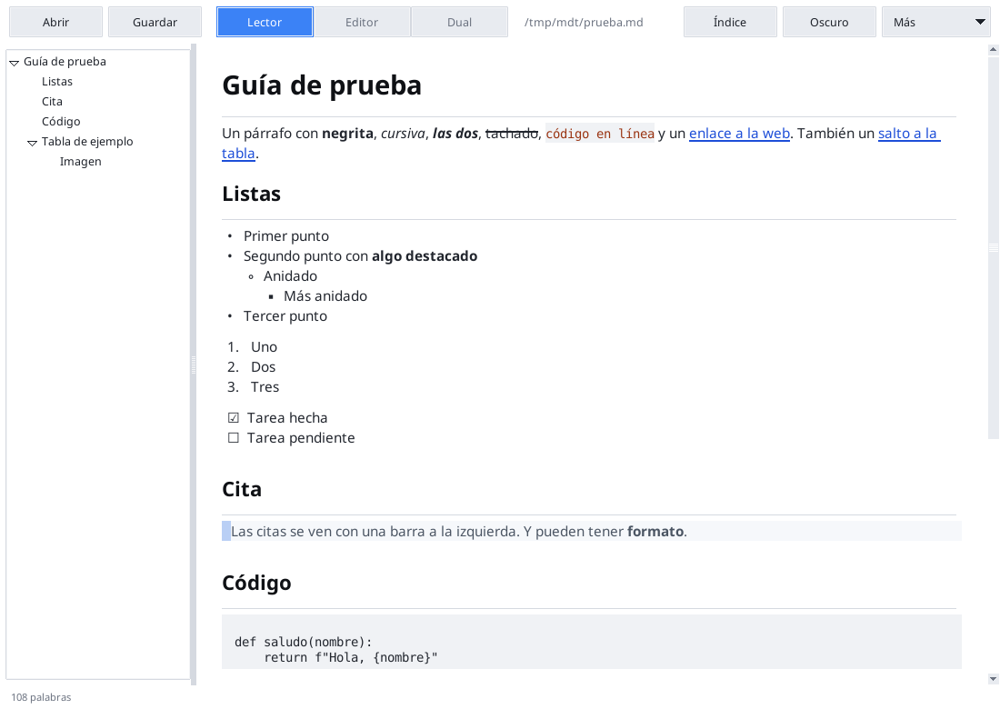
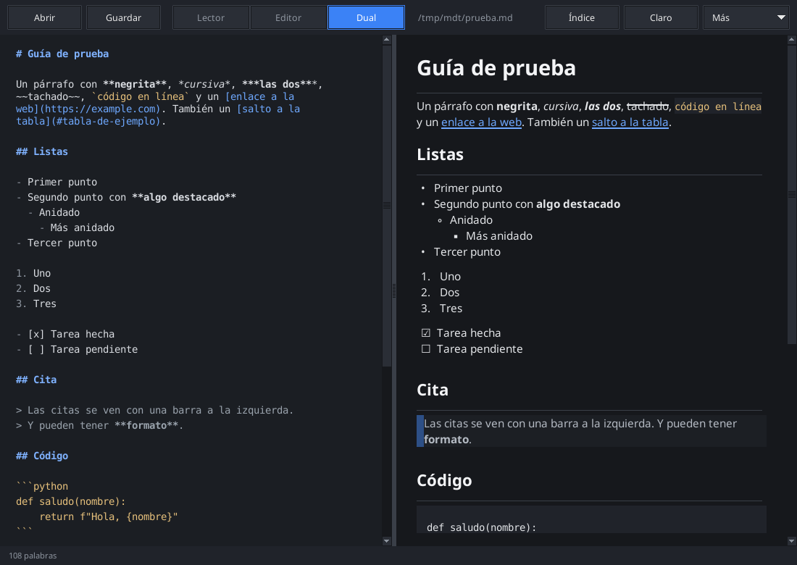

<!-- README.md -->
# md-reader

**Lee y edita Markdown**, en modo claro u oscuro, con el aspecto sencillo de [cam-ui](https://github.com/enderHugin/cam-ui).

**Descarga:** <https://enderhugin.github.io/md-reader/> (Windows y macOS)



## Qué hace

- **Lee con formato de verdad**: títulos, negrita, cursiva, tachado, listas anidadas, casillas de tareas, tablas, código, citas, líneas, enlaces e imágenes. Los enlaces a otra sección (`#…`) o a otro `.md` se abren dentro del programa.
- **Tres modos**: *Lector*, *Editor* (el texto Markdown tal cual, con un resaltado discreto) y *Dual* (los dos a la vez: lo que escribes se ve en el lector al momento). `Ctrl+E` cambia entre lector y editor en la misma ventana.
- **Modo claro u oscuro**, o el del sistema.
- **Índice lateral** con los títulos del documento.
- **Buscar** (`Ctrl+F`) y **zoom** (`Ctrl+=`, `Ctrl+-`, `Ctrl+0`).
- **Archivos recientes**.
- **Recarga sola** si el archivo cambia fuera. Si tienes cambios sin guardar, avisa en vez de pisarlos.
- **Guarda en el mismo formato** en que abrió el archivo: codificación, BOM y saltos de línea de Windows.
- En Windows, *Más ▸ Abrir los .md con md-reader* lo añade al «Abrir con» del explorador.
- **Se actualiza solo**, con las opciones de siempre: avisar, actualizar sin preguntar, o «vigilar sola», que se revela con `Ctrl+Shift+Alt+F12` en la ventana de actualizaciones.

| Claro | Dual |
|---|---|
|  |  |

## Atajos

| Atajo | Qué hace |
|---|---|
| `Ctrl+O` / `Ctrl+N` | abrir / nuevo |
| `Ctrl+S` / `Ctrl+Shift+S` | guardar / guardar como |
| `Ctrl+E` | lector ↔ editor |
| `Ctrl+F` | buscar (`Intro` / `Mayús+Intro`: siguiente / anterior) |
| `Ctrl+=` / `Ctrl+-` / `Ctrl+0` | zoom |
| `Ctrl+B` / `Ctrl+I` | editando: **negrita** / *cursiva* |
| `F5` | volver a leer el archivo |

## Desde el código

```bash
pip install markdown-it-py pillow
python md_reader.py documento.md
```

Las pruebas usan una ventana de verdad: `xvfb-run -a python tests/test_md_reader.py`.

**Cómo se instala y se publica:** el instalador, la página de descarga y las actualizaciones los genera [py-installer](https://github.com/enderHugin/py-installer) a partir de [`py-installer.toml`](py-installer.toml). `pyi_update.py` es su actualizador común; la copia que hay en este repo solo sirve para ejecutar el programa desde el código.

**Linux, todavía no:** el Python que instala `uv` en Linux trae un Tk sin fuentes suavizadas, y el texto se vería mal ([python-build-standalone#740](https://github.com/astral-sh/python-build-standalone/issues/740)). Desde el código, con el Python del sistema (`python3-tk`), funciona bien.

## Opinar y apoyar

- **Opinar o avisar de un fallo:** [abre un issue](https://github.com/enderHugin/md-reader/issues/new/choose). Hay plantillas para opinión, fallo y petición de función.
- **Apoyar:** md-reader es gratis y sin anuncios. Si te resulta útil, [invítame a un café en Ko-fi](https://ko-fi.com/jaimeluisolguinmesina). También está dentro del programa, en *Más ▸ Acerca de md-reader*.

La página (`site/`) sigue el estilo de las de cam-ui y widget-arena: ES/EN, una demo en vivo del modo Dual y la descarga según tu sistema. py-installer la publica junto a los instaladores.

## Licencia

MIT
